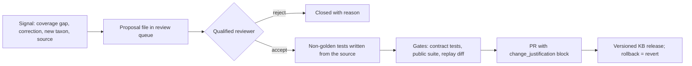

# 07 — Scientific knowledge and source authority

- **Status:** Draft — research proposal, not implemented
- **Owner:** Dendro Inspector maintainers
- **Date:** 2026-11-22
- **Last-verified:** 2026-11-22 (CURRENT statements checked against `36a961c`)

## Agent brief

| | |
|---|---|
| Spec ID | HAI-07 |
| Priority | P2 research |
| Goal | Grow knowledge beyond 28 locally maintained cards without admitting unconstrained model botany: citation-level provenance, a reviewed update workflow, and a strict separation of five kinds of statement |
| Implementation approved | **No** |
| Must not touch | Existing cards' values; `candidate_validation`; the loader's refusal to read `review-queue/` |
| Explicitly prohibited | Editing a botanical fact because one benchmark case failed (`AGENTS.md` §16); auto-promoting a draft; model-written card rules entering `knowledge/taxa/` without a named human reviewer |

## Current state

- **CURRENT.** 28 taxon cards with an AI-assisted review dated 2026-11-11; no independent
  dendrologist review; comparison and regional cards unreviewed
  ([dataset policy](../../dataset-policy.md#knowledge-cards-record-their-review-status)).
- **CURRENT.** `Provenance`: `source` (short text), `source_type` (`domain_prompt`,
  `field_guide`, `literature`, `expert_review`, `inferred`), region, `life_stage`, `season`,
  `confidence`, `review_state`, `reviewed_by`, `last_reviewed`. A rule may override the card's
  provenance. Citations with URLs sit in free-text `note` fields (example: the red oak bark
  rule in [`quercus.yaml`](../../../knowledge/taxa/quercus.yaml)).
- **CURRENT.** `ReferenceStatus` keeps "does this taxon exist and what is it documented to
  look like" apart from "does this photograph show it"
  ([`schemas/reference.py`](../../../src/dendro_inspector/schemas/reference.py)). Only
  operator-saved records ship; they can dispute, never verify.
- **CURRENT.** Drafts from reference records go to `knowledge/review-queue/`, are always
  unreviewed placeholders, and turn every documented feature into a *supporting* rule
  ([`knowledge/drafts.py`](../../../src/dendro_inspector/knowledge/drafts.py)).
- **CURRENT.** The domain prompt is the behavioural specification, edited only by its owner
  (`AGENTS.md` §12).

## Five kinds of statement — never merged

| # | Kind | Example | Lives in | Can support a verdict? |
|---|---|---|---|---|
| 1 | Botanical claim in reference literature | "Alder leaves have a symmetric base" | Knowledge (cards, contrast tables), with citation | Only as a *rule* applied to observations |
| 2 | Model-produced observation | `leaf.base_symmetry = symmetric` from photo 3 | Evidence packet | Yes, after trust projection |
| 3 | Validated structured evidence | Observation after admission, bound to an organism | Candidate support ids | Yes |
| 4 | Human field attestation | "This twig came off this trunk" | Attestation records | Capped |
| 5 | Final taxonomic decision | *Alnus*, genus, low | `FinalDecision` | Is the verdict |

A retrieved publication is kind 1. It is never evidence that the photographed tree has
the property (CURRENT principle in `references.py`, kept).

## Proposal

### 1. Citation-level provenance (PROPOSED)

Add a structured `KnowledgeSource` and let any rule cite one or more sources by ID, instead
of free text:

| Field | Purpose |
|---|---|
| `source_id` | Stable ID in a sources registry file |
| `kind` | `flora`, `peer_reviewed`, `university_resource`, `taxonomic_database`, `identification_key`, `herbarium_record`, `expert_communication`, `domain_prompt` |
| `title`, `authors`, `year`, `publisher` | Bibliographic identity |
| `url`, `doi` | Optional; never invented — absent is allowed |
| `retrieved_on` | Date a person or tool actually read it |
| `scope` | Region, life stages, seasons the source covers |
| `licence_note` | Whether wording or data may be reproduced |

Per rule: `source_ids`, `quote_or_paraphrase` (short), `diagnostic_strength` (reviewer's
ordinal label: `diagnostic`, `supporting`, `variable`), `known_lookalikes`, `contradicted_by`
(other source IDs), `review` (reviewer, qualification, date, scope), `kb_version`.

### 2. Taxonomic identity

Per taxon: accepted name, authority, synonyms with source, rank, and the taxonomic backbone
used (a named database release). Synonyms resolve user claims; they never create a card.
Taxonomic revisions are a versioned change with its own review.

**UNKNOWN:** which backbone (GBIF Backbone, POWO, World Flora Online, a regional flora)
should be authoritative for Eastern Europe, and under what licence. Owner decision.

### 3. Expert-curated update workflow

Every proposed update must carry: a source (kind 1), a reviewer, a rationale, non-golden
regression tests, versioned provenance and a rollback path (a revert of one commit). The
`AGENTS.md` §16 `change_justification` block is mandatory when the signal was a benchmark
or field case.

### 4. New taxa without auto-admission

A taxon proposed by a model (open-world), a reference record or an expert enters
`review-queue/` as an unreviewed draft (CURRENT mechanism). It becomes an admitted candidate
only when a person moves it into `knowledge/taxa/` with a review. Until then it may appear
only as an open-world hypothesis, under the existing bounds.

## Invariants

1. Nothing a model writes becomes a rule without a named human reviewer.
2. A source can never raise an image-identification confidence.
3. Absent URL or DOI is recorded as absent, never filled in by a model.
4. Every rule change is a reviewable diff with a rollback.

## Failure modes

| Failure | Control |
|---|---|
| Hallucinated citation | Sources registry entries need `retrieved_on` by a person or a logged tool fetch; CI checks every `source_id` resolves |
| Synonym confusion | Synonym table with backbone release; user-claim resolver tests |
| Regional mismatch | `scope` per source; rule applies only within scope |
| Knowledge tuned to a benchmark | §16 block; reviewer must not see the benchmark case's label when judging the rule |
| Review bottleneck | Expected; the system remains conservative while rules wait |

## Evaluation

- Count of rules with structured sources and named reviewers (coverage metric).
- Contract tests: every cited source exists; no family identity cites the domain prompt
  (CURRENT rule, kept).
- Replay diff on recorded traces for each KB release.

## Acceptance criteria for a future PR

- [ ] Sources registry and optional `source_ids` on rules; old cards load unchanged.
- [ ] Contract test for source resolution.
- [ ] No card value changed in the same PR.

## Open questions

- Who is a "qualified reviewer" for this project? Name the bar (degree, profession,
  experience) before the first external review ([08](08-human-ai-collaboration.md)).
- Licence compatibility of floras and keys with Apache-2.0 (`AGENTS.md` §14). **UNKNOWN.**
