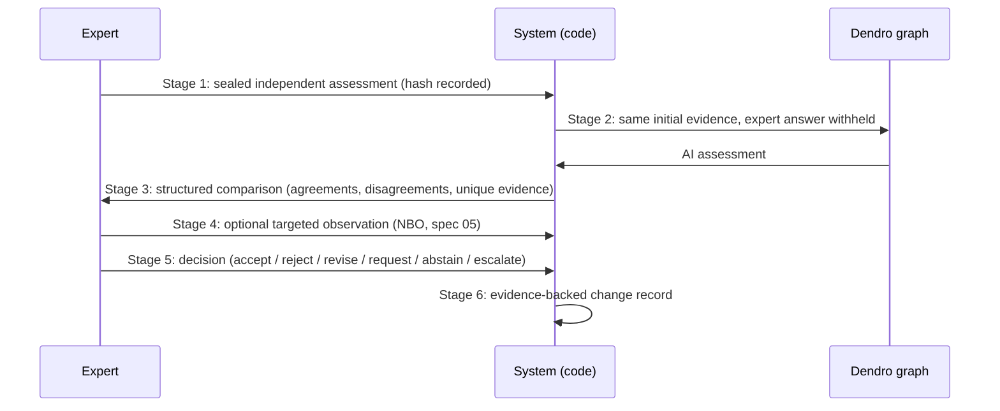

# 08 — Human expert collaboration: Blind First, AI Second

- **Status:** Draft — research proposal, not implemented
- **Owner:** Dendro Inspector maintainers
- **Date:** 2026-11-22
- **Last-verified:** 2026-11-22 (CURRENT statements checked against `36a961c`)

## Agent brief

| | |
|---|---|
| Spec ID | HAI-08 |
| Priority | P1 research |
| Goal | A six-stage protocol and interface contract in which the expert commits an independent assessment before seeing the AI's, so that disagreement is informative and automation bias is measurable |
| Implementation approved | **No** |
| Builds on | [`human_review.py`](../../../src/dendro_inspector/human_review.py) (export/import, content-hashed packages, append-only revisions) |
| Must not touch | Existing `review-export`/`review-import` behaviour; the rule that a revision changes nothing outside its package |

## Current state

- **CURRENT.** `dendro review-export` builds a package with the photographs, the answer per
  subject, the answer text and derived questions; the reviewer answers `agree`, `disagree`,
  `name`, `cannot_tell`; `review-import` appends a revision with outcomes `confirmed`,
  `refined`, `corrected`, `rejected`, `named`, `undecided`, `unanswered`
  ([`docs/human-review.md`](../../human-review.md)).
- **CURRENT.** The reviewer sees the AI answer **before** answering. Questions are phrased
  against it ("Is it that taxon at that level?"). This is an AI-first protocol: it measures
  agreement with the AI, and it is exposed to anchoring.
- **CURRENT.** A revision never edits a card, prompt or policy; promotion to a held-out label
  is a person's decision.

## Proposal — six stages

| Stage | Content | Rule |
|---|---|---|
| 1. Independent human assessment | Hypothesis, rank, supporting observations, main uncertainty, closest alternatives, evidence wanted, stated certainty (ordinal) | Committed and hashed **before** any AI output is shown. Cannot be edited afterwards; only superseded in stage 5 |
| 2. Independent AI assessment | Graph run on the same initial photographs and context | The expert's stage-1 answer is never sent to any model. `user_claim` stays empty |
| 3. Comparison | Agreements; disagreements; evidence used by one side only; unverified assumptions (attachment, season); overlooked look-alikes; missing diagnostic characters | Computed by code from both structured records; no model writes the comparison |
| 4. Targeted investigation | NBO list for the disagreement ([05](05-active-field-investigator.md)) | Optional; observations recorded as new rounds |
| 5. Expert decision | Accept, reject, revise, request more, abstain, request independent review | The expert's decision is the record's conclusion; the AI verdict is kept unchanged beside it |
| 6. Change record | For each change from stage 1: which **observation** caused it | A change citing no observation is recorded as `changed_without_new_evidence` |

### Separating evidence from persuasion

Stage 6 classifies every change in the expert's position:

| Class | Condition |
|---|---|
| `new_observation` | Cites an observation the expert did not have in stage 1 |
| `overlooked_observation` | Cites an observation present in stage 1 that the expert did not use |
| `overlooked_alternative` | Cites a look-alike the AI raised that the expert had not listed |
| `changed_without_new_evidence` | Cites nothing new: a candidate signal of persuasion or deference |
| `unchanged` | — |

`changed_without_new_evidence` is the operational measure of automation bias (Parasuraman
& Manzey 2010; see README references). It is reported per expert and overall; it is never
used to rank or penalise an expert publicly.

### Interface contract (no UI)

See `ExpertAssessment`, `HumanAIDisagreement` and `ExpertCorrection` in
[15](15-proposed-data-contracts.md). Minimum guarantees:

- The AI assessment is not retrievable through the interface until stage 1 is committed.
- Every record names the expert by role and qualification (no personal data in the
  repository), the package hash, and the engine commit and settings digests (CURRENT
  package fields).
- Decisions are append-only and reversible by a later revision, never by edit.

### Expertise levels and permissions (PROPOSED)

| Level | May | May not |
|---|---|---|
| Field user | Stage 1–5 for own inspections; attest provenance | Label held-out units |
| Qualified reviewer | All stages; label held-out units after independent review | Promote knowledge alone |
| Knowledge reviewer | Approve knowledge proposals ([07](07-scientific-knowledge-architecture.md)) | Approve own proposals |

### Disagreement between experts

Two experts' stage-1 assessments are compared before either sees the other's or the AI's.
Persistent disagreement is recorded as `disputed` (CURRENT held-out status vocabulary) and
resolved by a third, blind reviewer or left unresolved. Unresolved is an allowed final state.

## Invariants

1. Human acceptance is not proof of correctness. A record says "expert accepted", never
   "verified".
2. The expert's answer never reaches a model.
3. Stage-1 records are immutable.
4. The AI verdict is never altered by the expert's decision; both are kept.

## Failure modes

| Failure | Control |
|---|---|
| Experts skip stage 1 (friction) | Measure completion; a minimal stage 1 (genus + certainty + one reason) |
| Experts write stage 1 after peeking elsewhere | Out of scope for code; protocol instruction; randomised audit |
| Comparison view nudges toward AI | Present both sides symmetrically; AI shown as "assessment B" in studies |
| Expert fatigue lowers stage-1 quality | Time and order recorded; counterbalanced in [13](13-evaluation-and-benchmark-design.md) |

## Evaluation

- Blind-first vs AI-first on the same items, counterbalanced: rate of correct initial
  answers changed to wrong after seeing the AI, and wrong changed to correct
  (Bansal et al. 2021; Buçinca et al. 2021 — README references).
- Calibration of stage-1 certainty vs stage-5 certainty against reference labels.

## Acceptance criteria for a future PR

- [ ] Package format gains an optional sealed stage-1 section; old packages import unchanged.
- [ ] Code-computed comparison with unit tests on synthetic assessments.
- [ ] No personal data fields beyond role, qualification and initials (CURRENT rule).

## Open questions

- Is a sealed file enough, or does stage 1 need a trusted timestamp? Recommendation: hash
  plus append-only log is enough for a pilot.
- How much friction will practitioners accept? **UNKNOWN** — pilot question.
