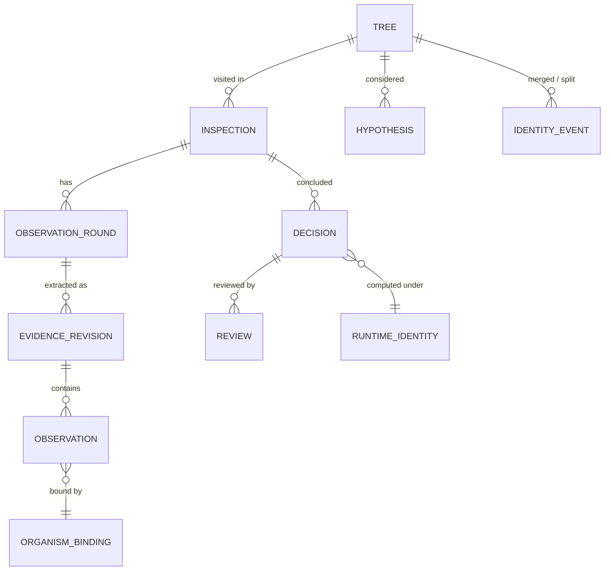

# 09 — Longitudinal tree intelligence

- **Status:** Draft — research proposal, **deferred** (see [17](17-evil-duck-review.md), Q9)
- **Owner:** Dendro Inspector maintainers
- **Date:** 2026-11-22
- **Last-verified:** 2026-11-22 (CURRENT statements checked against `36a961c`)

## Agent brief

| | |
|---|---|
| Spec ID | HAI-09 |
| Priority | P3 — deferred until HAI-05 and HAI-08 show value |
| Goal | Treat a tree as a persistent scientific object: identity, inspections, observations, hypotheses, decisions and reviews across seasons and model versions |
| Implementation approved | **No**. Do not build a registry, do not change the results database |
| Must not touch | `scripts/batch/results-schema.sql`, the results database, trace schemas |

## Current state

- **CURRENT.** Each inspection is independent (`CaseInput.case_id`). Nothing links two
  inspections of one tree.
- **CURRENT.** The held-out manifest has `group_id` naming the physical tree or lot, for
  evaluation independence only ([evaluation](../../evaluation.md#the-held-out-set)).
- **CURRENT.** A results database stores cases, decisions, labels, units and grades
  ([`docs/results-database.md`](../../results-database.md)). It is an evaluation store, not a
  tree registry.
- **CURRENT.** Runtime identity records code, prompts, knowledge digest and settings per run
  ([`observability/identity.py`](../../../src/dendro_inspector/observability/identity.py)),
  which is what makes later re-evaluation possible.

## Proposal

### Data model (PROPOSED)

`EVIDENCE_REVISION`, `DECISION` and `RUNTIME_IDENTITY` already exist inside a trace
(CURRENT). New: `TREE`, `INSPECTION` grouping, `IDENTITY_EVENT`, cross-inspection
`ORGANISM_BINDING`.

### Rules

1. **Identity is a hypothesis.** "Same tree as last spring" is a binding with a basis
   (expert attestation, tag number, photo match), recorded like any other
   ([06](06-organism-binding-and-provenance.md)).
2. **Merges and splits are events**, never overwrites. A wrong merge is undone by a split
   event; every decision computed on merged evidence is flagged for recomputation.
3. **Seasonal evidence accumulates; decisions are recomputed**, not inherited. A spring
   fruit observation plus an autumn leaf observation may jointly support a claim only when
   both are bound to the tree with allowed bases.
4. **Conflict is surfaced.** Historical and current evidence that disagree produce a
   `conflicting_evidence` state for review, never a silent latest-wins.
5. **Reproducibility across upgrades.** Every decision keeps its runtime identity; a new
   model or KB version produces a new decision beside the old one; differences are a
   report, not a correction.
6. **Taxonomy vs condition.** Health and condition observations, if ever recorded, live in a
   separate record type and never feed identification. Tree risk assessment is out of scope
   ([dataset policy](../../dataset-policy.md#what-the-system-must-not-be-used-for)).
7. **Taxonomic name changes** (synonymy, revisions) re-label decisions through the backbone
   version ([07](07-scientific-knowledge-architecture.md)), keeping the original name.

### Privacy and ownership

- Exact locations are personal data when they reveal a private property or a person's
  movements ([dataset policy](../../dataset-policy.md#personal-data)). Store region-level
  location by default; precise coordinates only with explicit consent and a retention
  period.
- Owner of a record: the person who collected it. Export and deletion on request; deletion
  removes photographs and precise locations, keeps anonymised decision statistics only if
  consented.
- Nothing from a tree registry enters this public repository.

### Duplicate tree detection

Candidate duplicates are *suggested* (same region, overlapping photographs, matching tag)
and never merged automatically.

## Why deferred

**HYPOTHESIS** (unmeasured): persistent records improve identification mainly through
multi-season evidence. That benefit can be tested more cheaply with resumable
investigations ([05](05-active-field-investigator.md)) that span two visits, without a
registry. Build a registry only if that test shows multi-visit value and a user group needs
it ([17](17-evil-duck-review.md), Q9).

## Failure modes

| Failure | Control |
|---|---|
| Identity collision (two trees merged) | Events + recomputation; no auto-merge |
| Stale decision presented as current | Decision shows its runtime identity and date |
| Location leak | Region-level default; consent; retention |
| Scope creep into risk assessment | Separate record type; explicit non-goal |

## Acceptance criteria (if ever un-deferred)

- [ ] Owner approval and a data-protection review.
- [ ] Storage outside this repository.
- [ ] Merge/split replay tests.
