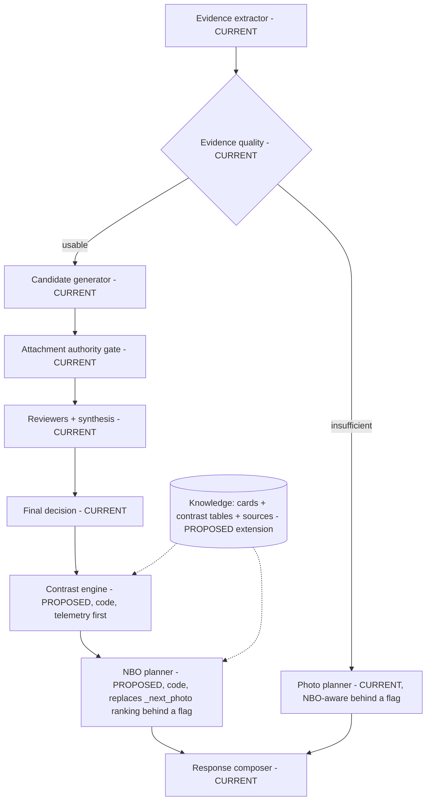
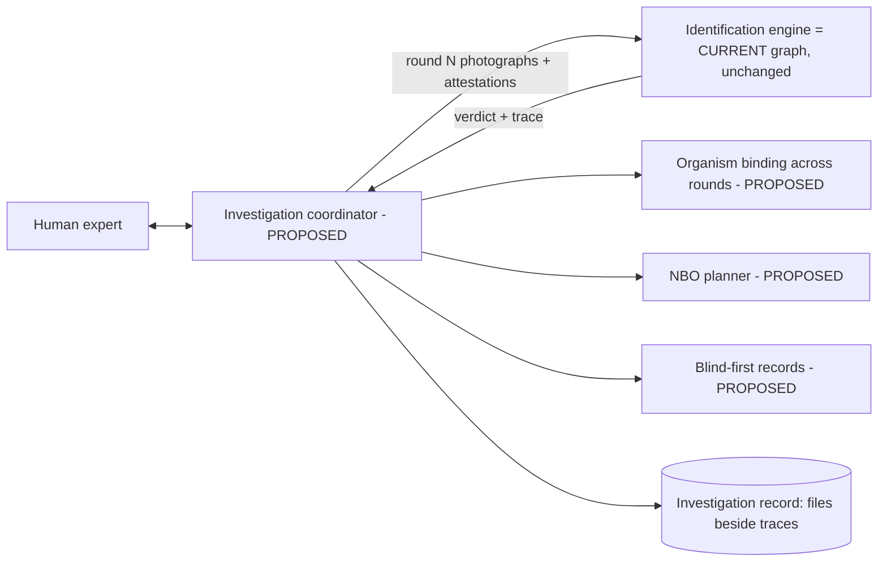
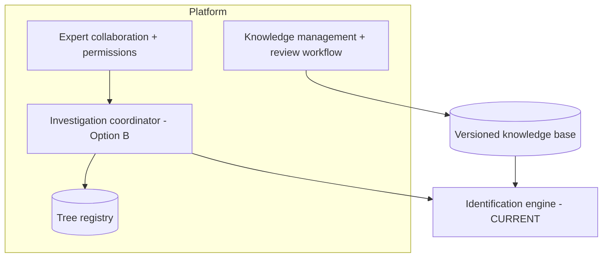

# 14 — Architecture options

- **Status:** Draft — research proposal, not implemented
- **Owner:** Dendro Inspector maintainers
- **Date:** 2026-11-22
- **Last-verified:** 2026-11-22 (CURRENT statements checked against `36a961c`)

## Agent brief

- **Recommendation:** **Option A**, staged, until [13](13-evaluation-and-benchmark-design.md)
  stage 3 results exist. Option B only if A's additions start to entangle the identification
  graph. Option C is deferred.
- **Default rule:** the simplest design that can be evaluated. No new service, database,
  vector index, orchestration framework or container is justified by anything measured so
  far. Kubernetes is a deployment concern, not an architecture argument.

## Option A — minimal evolutionary extension

Extend the existing graph and knowledge with deterministic modules. No new model node is
required.

| Aspect | Content |
|---|---|
| Components | Contrast engine (HAI-04), NBO ranker (HAI-05), provenance basis telemetry (HAI-06), contrast tables and sources in `knowledge/` |
| Responsibilities | All new logic is deterministic code over the evidence packet; verdict authority unchanged |
| Integration boundary | After `final_decision` (reads verdict, never writes it); inside `photo_planner`/`_next_photo` behind a setting |
| Data flow | Evidence packet + knowledge → contrast artifacts → NBO list → `CaseResponse` |
| Contracts | `TaxonomicComparison`, `NextBestObservation` as trace/response additions ([15](15-proposed-data-contracts.md)) |
| Migration | Optional fields; trace schema version bump; old traces readable |
| Backward compatibility | Flags off = released behaviour; public suite byte-identical |
| Operational complexity | Low: no new process or store |
| Scientific value | Directly tests H5 and H6 |
| Failure modes | Contrast data errors; over-narrowing (C1); request tables wrong |
| Cost | Zero extra model calls |
| Security/privacy | No new data stored |
| Evaluation | Replay (stage 2), field pilot (stage 3) |
| Adopt if | Always first |
| Reject if | Contrast data cannot be reviewed for any pair (then nothing to compute) |

**Limitation:** no resumable investigation across rounds; each round is still a separate
inspection, linked only by the human.

## Option B — modular investigation subsystem

A separate **investigation coordinator** around an unchanged identification engine.

| Aspect | Content |
|---|---|
| Components | Coordinator (state machine of rounds), cross-round binding, NBO, blind-first records |
| Responsibilities | Coordinator owns the investigation; engine stays a bounded decision system called per round |
| Integration boundary | Public API (`inspect`) — the modernisation spec's N5 ([`core-modernisation.md`](../../specs/core-modernisation.md)); engine never knows about investigations |
| Data flow | Round inputs → engine → coordinator merges under binding rules → recompute verdict on bound evidence → NBO |
| Contracts | `FieldInspection`, `OrganismBinding`, `ExpertAssessment`, `NextBestObservation` |
| Migration | New package or module; engine unchanged |
| Backward compatibility | Complete: engine API unchanged |
| Operational complexity | Medium: investigation files, resume logic |
| Scientific value | Tests H2, H3, H7 and multi-round H6 |
| Failure modes | Cross-round contamination; coordinator recomputes verdicts with rules that drift from the engine's |
| Cost | Per round = one engine run; no extra calls |
| Security/privacy | Investigation records hold photographs and locations: local storage, retention rules |
| Evaluation | Stage 3 pilot, stage 5 study |
| Adopt if | Option A shows value and resume is needed for the study |
| Reject if | The recomputation over merged evidence cannot reuse the engine's own decision code (a second decision engine is the bug `AGENTS.md` warns about) |

**Key constraint:** the coordinator must call the engine's deterministic decision code on
merged evidence, never re-implement it.

## Option C — longitudinal human–AI platform

Persistent tree identity, expert collaboration, knowledge management, history.

| Aspect | Content |
|---|---|
| Components | Registry, identity events, multi-user permissions, knowledge review tooling |
| Operational complexity | High: database, authentication, privacy compliance, backups |
| Scientific value | Multi-season evidence; but testable more cheaply with two-visit investigations (Option B) |
| Security/privacy | Locations and photographs of private property; consent, export, deletion |
| Cost | Hosting and maintenance; no evidence yet that users need it |
| Adopt if | Option B shows multi-visit value **and** an identified user group needs persistent records |
| Reject now because | No measurement supports it; it would be built before the core hypothesis is tested ([17](17-evil-duck-review.md), Q9) |

## What is not needed (any option)

| Item | Why not |
|---|---|
| More model agents | Four of seven review responsibilities are code ([11](11-adversarial-scientific-review.md)); CURRENT evidence shows review already costs correct names |
| Vector index / RAG over literature | Literature is kind-1 knowledge and must go through human review ([07](07-scientific-knowledge-architecture.md)); retrieval into prompts would re-open unconstrained botany |
| Agent framework | `AGENTS.md` §12: custom executor, no framework |
| New database for Options A/B | Files beside traces suffice for pilot scale |
| Distributed services | No load or latency evidence requires them |

## Assumptions behind the recommendation

1. Contrast data for a handful of look-alike pairs can be reviewed by a qualified person
   (**UNKNOWN** — depends on recruiting a reviewer).
2. The ranking value of NBO can be estimated offline before any field work (HAI-E1).
3. The engine's decision code can be called on a merged evidence packet without change
   (**UNKNOWN** — verify against `final_decision` before Option B).
